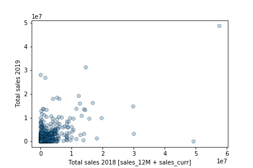
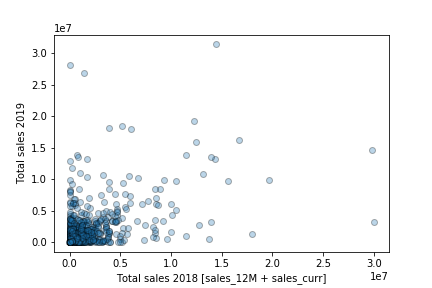
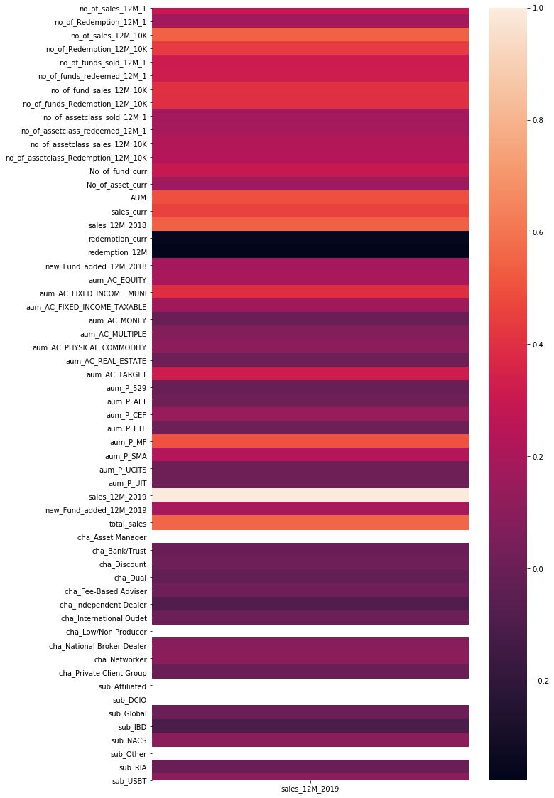
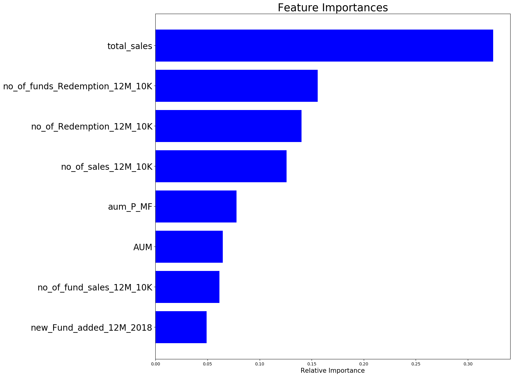
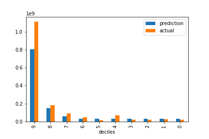
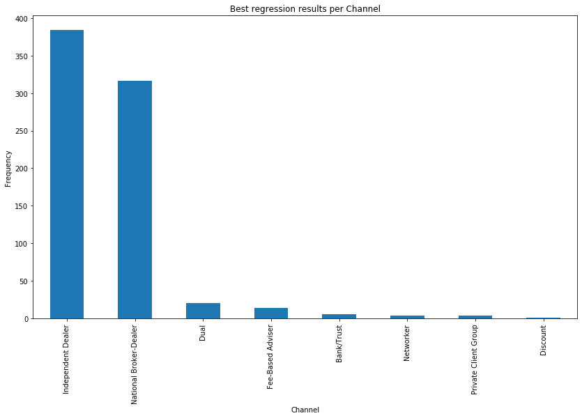
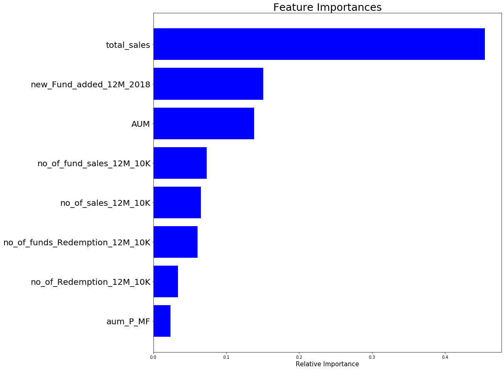
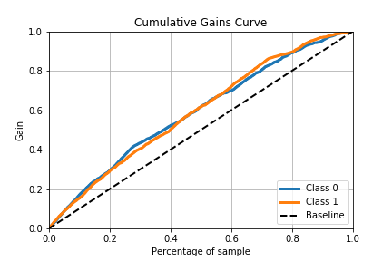
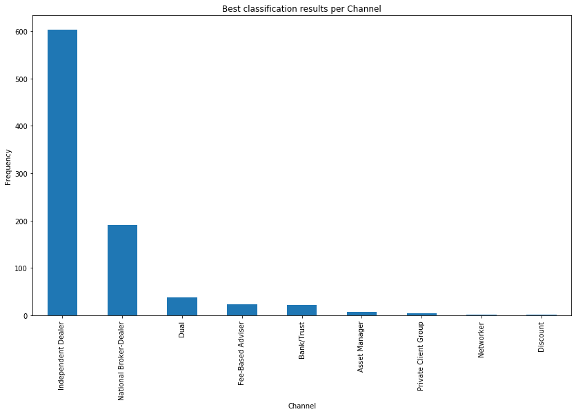

# Targeting Financial Advisors for Nuveen: ML Capstone

Final project for the Columbia University / Emeritus PGDMLAI program (December 2020), by Felipe Coelho Costa.

Using 2018 activity for about 10,000 financial advisors, this project predicts two things for 2019: how much each advisor will sell, and whether they will add a new fund. The goal is to help Nuveen's sales and marketing teams decide where to focus.

| Task | Model | Train | Test |
|---|---|---|---|
| Regression: 2019 sales | XGBoost regressor | R² 0.511 | R² 0.515 |
| Classification: new fund added in 2019 | XGBoost classifier with SMOTE | Accuracy 0.638 (balanced) | Accuracy 0.622 (original class mix) |

## Business context

Nuveen, owned by TIAA, is a mutual fund company headquartered in Chicago. It sells its funds through investment professionals such as brokers, financial planners and financial advisors.

- **Revenue model:** Nuveen charges a percentage of assets under management (AUM), so revenue grows with the amount sold and how long it stays invested.
- **Goals:** acquire new clients cost-effectively, sell more to existing clients and reduce redemptions.
- **Why targeting matters:** the market is crowded, with 9,599 mutual funds in 2018, and sales channels such as wholesalers are expensive. A relatively small share of clients probably generates a high share of the profit.

## Objectives

Using 2018 data to improve sales and marketing targeting:

1. Estimate each advisor's **2019 sales** (regression).
2. Predict the **probability of an advisor adding a new fund in 2019** (classification).

## Data

The data is **not included in this repository** because it is confidential client data supplied for the course.

| Source | Contents |
|---|---|
| Transactions 2018 | Per-advisor sales and redemption counts and amounts, funds and asset classes sold or redeemed, AUM by asset class and product type, new funds added |
| Transactions 2019 | Targets: 12-month sales and new funds added |
| Firm information | Advisor channel and sub-channel |

## Approach

### 1. Preprocessing

- Merged the sources into one table per advisor.
- Created `total_sales` as the 2018 12-month sales plus current-month sales.
- Treated negative sales as sign errors and multiplied them by -1.
- Set negative AUM values to zero.
- Removed a few extreme records, taking the data from 10,005 to 10,001 advisors.
- Split the data 75/25 into 7,500 training and 2,501 test records.

<table>
  <tr>
    <th>Total sales, before outlier removal</th>
    <th>Total sales, after outlier removal</th>
  </tr>
  <tr>
    <td></td>
    <td></td>
  </tr>
</table>

### 2. Feature selection

Features were chosen from their correlation with the target. The same eight were used for both models:

| Feature | Meaning |
|---|---|
| `total_sales` | 2018 12-month sales plus current-month sales |
| `AUM` | Assets under management at the 2018 refresh date |
| `aum_P_MF` | AUM in mutual funds |
| `new_Fund_added_12M_2018` | New funds added in the last 12 months |
| `no_of_sales_12M_10K` | Number of sales of at least $10K in the last 12 months |
| `no_of_Redemption_12M_10K` | Number of redemptions of at least $10K in the last 12 months |
| `no_of_fund_sales_12M_10K` | Number of funds sold with at least $10K in sales |
| `no_of_funds_Redemption_12M_10K` | Number of funds redeemed with at least $10K in redemptions |

<details>
<summary>Correlation of all attributes with 2019 sales</summary>
<br>

</details>

### 3. Modeling

Several regressors were tried, including linear models, tree ensembles and gradient boosting, and XGBoost gave the best results. Its tuned settings were `max_depth=4`, `min_child_weight=3`, `subsample=1.0`, `colsample_bytree=1.0` and `learning_rate=0.015`.

The classifier also uses XGBoost. About 25% of advisors added a new fund, so SMOTE was used to balance the training classes.

## Results

### Regression: 2019 sales

The model explains about half of the variance in 2019 sales, and train and test scores are nearly identical. Prior sales is by far the strongest predictor, followed by redemption and large-sale activity.



Sales are heavily concentrated in the highest predicted decile, which the model underpredicts. The 8th decile (second highest) is also a candidate for targeting. Independent Dealer and National Broker-Dealer are the most common channels in the top decile, and NACS and IBD the most common sub-channels. These charts use training data.

<table>
  <tr>
    <th>Predicted and actual sales by decile</th>
    <th>Channels in the top decile</th>
  </tr>
  <tr>
    <td></td>
    <td></td>
  </tr>
</table>

### Classification: new fund added in 2019

Prior sales is again the strongest predictor, followed by new funds added in 2018 and AUM.



Ranking advisors by predicted probability finds positive cases better than chance on the rebalanced test set, as the gains curve shows. In the lift table, the share of actual positives rises from 21% in the lowest bin to 82% in the highest. The bins were intended as deciles, but duplicate probability edges reduced them to eight.

| Probability bin | Baseline | Actual positives | Records |
|---:|---:|---:|---:|
| 1 (lowest) | 50% | 21.03% | 1,265 |
| 2 | 50% | 42.26% | 3,779 |
| 3 | 50% | 36.27% | 612 |
| 4 | 50% | 51.86% | 1,157 |
| 5 | 50% | 53.74% | 1,029 |
| 6 | 50% | 61.76% | 1,135 |
| 7 | 50% | 67.06% | 1,105 |
| 8 (highest) | 50% | 82.23% | 1,120 |

Independent Dealer is by far the most common channel in the highest bin, and IBD and NACS the most common sub-channels.

<table>
  <tr>
    <th>Cumulative gains on the rebalanced test set</th>
    <th>Channels in the highest bin</th>
  </tr>
  <tr>
    <td></td>
    <td></td>
  </tr>
</table>

## Recommendations

- **Prioritize the strongest signals:** focus on the attributes with the highest feature importance, especially prior sales.
- **Start with the top groups:** target the highest predicted groups, then analyze each decile for further client patterns.
- **Collect richer data:** attributes such as dates of sales and client profiles could improve the models, since the distribution of the current inputs limits performance, particularly for regression.

## Limitations

- **Classifier accuracy:** the test accuracy of 0.622 is below the 0.752 achieved by always predicting "no new fund". An XGBoost model trained without SMOTE scored 0.750 but found only 7% of the advisors who added a fund. The model is therefore more useful for ranking advisors than for yes/no predictions.
- **Lift table:** it is calculated on the SMOTE-balanced training data, which includes synthetic records, so the 82% is an in-sample figure and not an expected real-world rate. It should be recalculated on the untouched test set.
- **Decile and channel charts:** these also use training data, and channel counts are not adjusted for how common each channel is overall.
- **Gains curve:** the test set was rebalanced with SMOTE for this chart, so it includes synthetic records.
- **Feature selection:** correlations were calculated on the full dataset before the split, which may slightly favor the test scores.

## Repository contents

```text
├── capstone.ipynb    Full analysis notebook, with confidential outputs removed
├── figures/          Figures from the final presentation
└── README.md
```

## About the notebook

- **Removed content:** saved outputs showing advisor IDs or per-advisor rows, plus local file paths and warning messages. The analysis code is unchanged apart from the working-directory line.
- **Run order:** this is a working notebook and its cells were not run strictly top to bottom, so some saved outputs show errors. That includes the cells for the classification channel charts, so those charts come from the presentation. The "Other way" section is earlier exploratory work.
- **Running it:** you need the original data files, which are not public. It was written in 2020 with xgboost 1.2 and may need package versions from that period. Main dependencies are `pandas`, `numpy`, `scikit-learn`, `xgboost`, `imbalanced-learn`, `scikit-plot`, `seaborn`, `matplotlib` and `openpyxl`.
